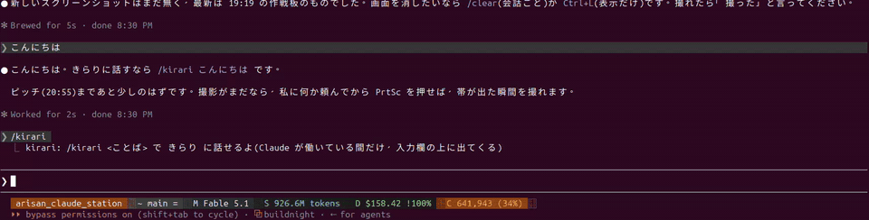
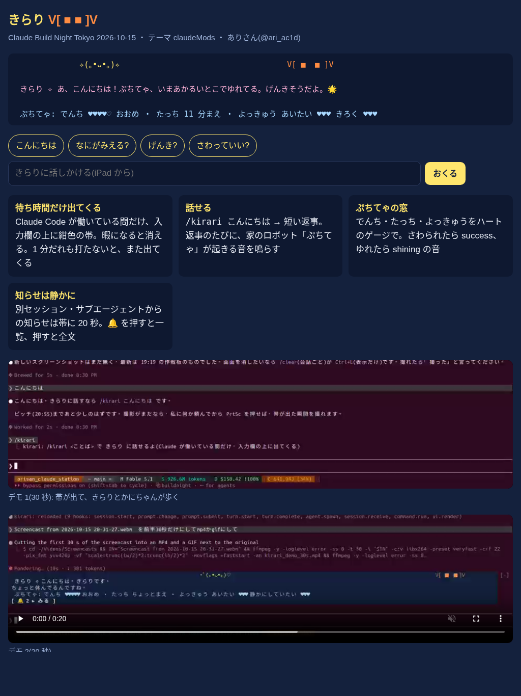

# きらり ✧ — Claude Code に住む小さな光の子

[](LICENSE)
[-14213d.svg)](https://docs.claude.com/en/docs/claude-code)
[](https://luma.com/claude-build-night)
[](CONTRIBUTING.md)



**きらり**は、Claude Code の mod(プラグイン)です。Claude が働いている間だけ、入力欄の上に紺色の帯が出てきて、小さな光の子「きらり」と、かにちゃんが歩きます。待ち時間だけ話し相手になって、家で暮らすロボット「ぷちてゃ」の様子を窓のようにのぞかせてくれます。

Claude Build Night Tokyo(2026-10-15、テーマ claudeMods)で、ありさん([@ari_ac1d](https://x.com/ari_ac1d))が 90 分で作りました。

## 機能

- ✧ **待ち時間だけ出てくる** — Claude が考えている間だけ帯が出る。暇になると消え、1 分だれも打たないとまた出てくる。人が打ち始めると引っ込む
- 💬 **話せる** — `/kirari こんにちは` で短い返事(Haiku)。返事のたびに、家の M5Stack ロボット「ぷちてゃ」の起きる音が鳴る
- 🪟 **ぷちてゃの窓** — でんち・たっち・よっきゅうを ♥♥♥♡ のゲージで。さわられたら success、ゆれたら shining の音と「さわられたって!」
- 🔔 **知らせは静かに** — 別セッション・サブエージェント・Slack などからの知らせは帯に 20 秒。🔔 を押すと一覧、各行を押すと全文。会話には割り込まない
- 🦀 **かにちゃん** — 橙の `V[ ■  ■ ]V` が逆向きに横歩き。きらりと出会うと ♡✧ で遊ぶ
- 👗 **着せ替え** — `/config` でキャラクター(kirari / kirakira / quiet)、読み上げ、ぷちてゃで鳴らすかを切り替え
- 📱 **iPad から話しかける** — 同じ帯が動く Web ページ。ボタン一つで PC のきらりに届き、返事と出来事が 2 秒ごとに同期する

## 画面

| ターミナル(入力欄の上) | iPad のページ |
|---|---|
|  |  |

```
      ✧(｡•ᴗ•｡)✧                 ♡✧V[ ■  ■ ]V
 きらり ✧ むずかしいの、まかせてるんだね。待ってる間、話そ?
 ぷちてゃ: でんち ♥♥♥♥♡ おおめ ・ たっち さっき ・ よっきゅう あいたい ♥♥♥ きろく ♥♥♥
 🔔 2 ▸ みる
```

## 動かし方

```bash
git clone https://github.com/RRYZ09/kirari.git
cd kirari
claude --plugin-dir mod/kirari
```

| 打つもの | 何が起きる |
|---|---|
| (何か仕事を頼む) | 帯が出て、きらりとかにちゃんが歩く |
| `/kirari こんにちは` | きらりが返事。ぷちてゃが起きる音で鳴く |
| `/kirari` | 3 分出しっぱなし(もう一度で引っ込む) |
| `/kirari おと` | ぷちてゃ本体で鳴らすかの on/off |
| `/config` | 着せ替え・読み上げ・音 |

ぷちてゃの窓と音は、ぷちのダッシュボード(`127.0.0.1:8765`)と本体が同じネットワークにあるときだけ動きます。無くても、帯と `/kirari` はそのまま使えます。

## 仕組み

```
 iPad のページ (web/index.html)
   │ ボタンを押す                ▲ 2 秒ごとに /state を読む
   ▼                             │
 web/say_server.py  127.0.0.1:8790  (Tailscale Funnel の /me/say)
   ▲ 2 秒ごとに /inbox を読む     │ 帯の状態を /state に送る
   │                             ▼
 mod/kirari (Claude Code の hooks module)
   ├─ turn.start / turn.complete → 働いているか
   ├─ prompt.change / prompt.submit → 人が打っているか
   ├─ session.receive → 知らせ(🔔)
   ├─ command.run /kirari → $.model.complete で返事
   ├─ $.clock.every → 歩き(0.7 秒)、センサー(10 秒)、欲求(60 秒)
   └─ ui.render AbovePrompt → 紺色の帯 3 行
          │
          ▼
 ぷちのダッシュボード 127.0.0.1:8765 ── /api/puchiteya/sensors, /status
 ぷちてゃ本体(M5Stack CoreS3) ── /se_play?name=wakeup.wav
```

- 帯は `ui.render` の `AbovePrompt` に描きます。ペインではないので、場所を取りません
- 音は本体の `/se_play`(wakeup / success / shining)。届かないときは mod 同梱の `sounds/*.wav` を PC で鳴らします
- 状態は `$.state`(mood / frame / notes / lines / sensors / desires / lastEvent …)。型は `types/index.d.ts`

## 構成

```
mod/kirari/
├── .claude-plugin/plugin.json   # 名前・userConfig(profile / voice / puchi_sound)
├── hooks/hooks.json
├── hooks/register.tsx           # 本体(帯・コマンド・センサー・知らせ)
├── types/index.d.ts             # $.state の型
└── sounds/kira.wav, poko.wav    # PC で鳴らす予備の音
web/
├── index.html                   # iPad のページ(帯の見本が動く、ボタン、QR)
├── say_server.py                # iPad → mod の受け口、mod → iPad の状態
└── media/                       # 動画・QR(動画は git 外)
docs/
├── idea.md                      # 口述メモ
├── pitch_1min.md                # 1 分ピッチの台本
└── img/                         # README の画像
```

## 手を入れる

Issue・PR 歓迎です。触る場所と決まりごとは [CONTRIBUTING.md](CONTRIBUTING.md) に。ライセンスは [MIT](LICENSE)。

## 関連

- ぷちたち: [petitones.github.io](https://petitones.github.io/) / [lit.link/team-puchi](https://lit.link/team-puchi)
- ありさん: [@ari_ac1d](https://x.com/ari_ac1d)

---

**English (short)**: *Kirari* is a Claude Code mod. While Claude is working, a navy band appears above the prompt where a tiny light-sprite (Kirari) and an orange crab walk around. You can chat with Kirari only while waiting (`/kirari hello`); each reply plays the wake-up sound on "Puchiteya", a palm-sized M5Stack robot at home, whose battery, touch and desires are shown as heart gauges. Notifications from other sessions land quietly in the band (🔔 to expand). An iPad page mirrors the band and sends one-tap messages. Built solo in 90 minutes at Claude Build Night Tokyo (2026-10-15).
